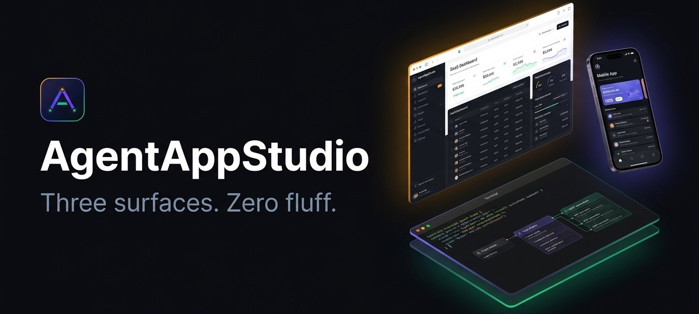
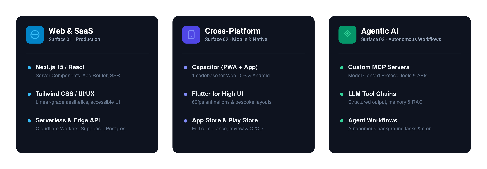

 

> *"Three surfaces. One builder who knows all three. Zero fluff."*

**AgentAppStudio** is a specialized software studio building production-grade applications at the intersection of modern Web, Cross-Platform Mobile, and Agentic AI.

---

## 🎯 Three Surfaces

Most studios do one thing. We pick the right surface for the problem — and articulate the tradeoffs upfront before you commit to a costly rewrite:

  

### 1. Production Web Apps & SaaS
Clean, high-performance dashboards, platforms, and SaaS products built with Next.js, TypeScript, and modern headless architectures.

### 2. Cross-Platform Mobile
Unified single-codebase deployment for iOS and Android using Capacitor, React Native, or Flutter, tailored to performance and launch velocity requirements.

### 3. Agentic AI & Model Context Protocol (MCP)
Custom MCP servers, background worker agents, and tool integrations that put generative AI to work autonomously inside business operations.

---

## 📦 Open Source Kits & Starter Blueprints

This organization hosts public templates, architectural patterns, and reusable tools developed at AgentAppStudio:
- **MCP Server Templates**: Production-ready Python and TypeScript boilerplate for building custom Model Context Protocol tools.
- **Cross-Platform Scaffolds**: Pre-configured Capacitor + Next.js shells with bi-directional native bridge support.
- **Agent Workflow Blueprints**: State machine & structured output recipes for mission-critical tasks.

---

## 🌐 Official Channels & Connect

| Channel | Link | Handle / Note |
|---|---|---|
| 🌐 **Website** | [agentappstudio.com](https://agentappstudio.com) | Official portfolio & services |
| 💼 **LinkedIn** | [linkedin.com/company/agentappstudio](https://linkedin.com/company/agentappstudio) | Studio updates & technical breakdowns |
| 🐦 **X (Twitter)** | [x.com/agentappstudio](https://x.com/agentappstudio) | `@agentappstudio` — Launches & engineering tips |
| 📘 **Facebook** | [facebook.com/agentappstudio](https://facebook.com/agentappstudio) | Tech community & product releases |
| 📺 **YouTube** | [youtube.com/@agentappstudio](https://youtube.com/@agentappstudio) | App breakdowns & architecture walk-throughs |
| ✉️ **Inquiries** | [contact@tuannguyen.dev](mailto:contact@tuannguyen.dev) | Project proposals & partnerships |

---

  © 2026 AgentAppStudio. Studio Lead: <a href="https://tuannguyen.dev">Nguyen Thanh Tuan, PhD</a>. Released under the MIT License.

